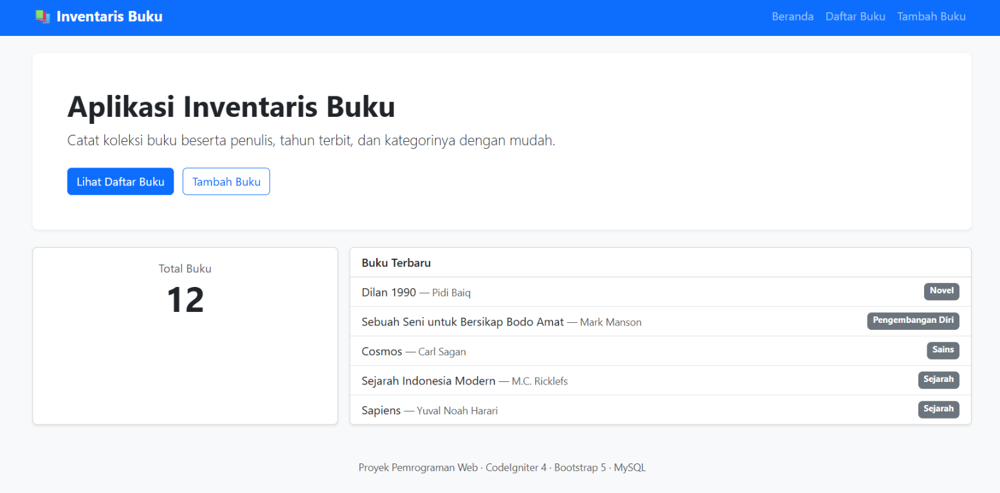
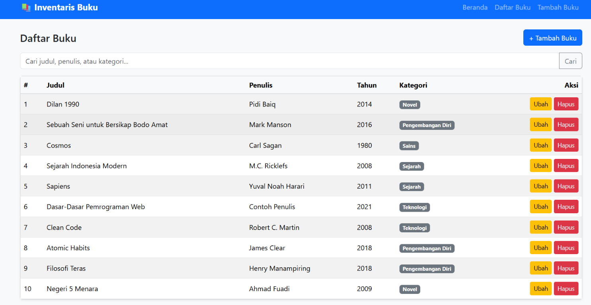
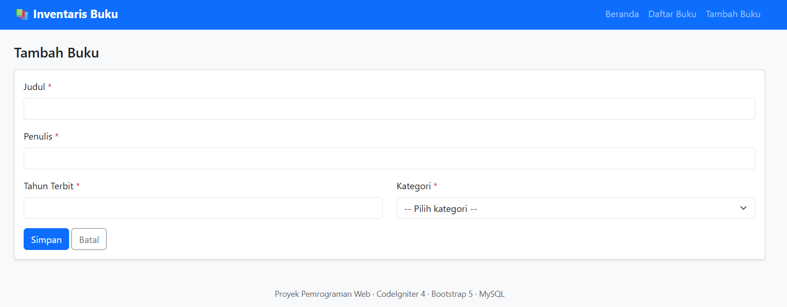

# Aplikasi Inventaris Buku (CodeIgniter 4 + Bootstrap 5 + MySQL)

Aplikasi web sederhana untuk mencatat koleksi buku: judul, penulis, tahun terbit, dan kategori.
Fitur: CRUD lengkap, validasi, pesan sukses, konfirmasi hapus, pencarian, pagination, tampilan responsif.

## Identitas Mahasiswa

- **NIM:** 240631100010
- **Nama:** Moh Habib Azka Alawi Saekhon D
 
## Daftar Halaman

| URL | Fungsi |
|---|---|
| `/` | Beranda (nama aplikasi, total buku, buku terbaru) |
| `/buku` | Daftar buku + pencarian + pagination |
| `/buku/tambah` | Form tambah buku |
| `/buku/ubah/{id}` | Form ubah buku |
| `POST /buku/hapus/{id}` | Hapus buku (dengan konfirmasi) |

### Penjelasan Tampilan

#### Beranda

Beranda menjadi halaman awal aplikasi. Bagian ini menyediakan navigasi menuju daftar buku dan form penambahan, menampilkan jumlah seluruh buku yang tersimpan, serta menampilkan beberapa buku terbaru beserta penulis dan kategorinya.

#### Daftar Buku

Halaman daftar buku menampilkan koleksi dalam tabel berisi judul, penulis, tahun terbit, dan kategori. Kolom pencarian dapat digunakan untuk mencari berdasarkan judul, penulis, atau kategori. Tombol **Ubah** dan **Hapus** tersedia pada setiap baris, sedangkan tombol **Tambah Buku** membuka form untuk memasukkan data baru. Daftar juga mendukung pagination.

#### Form Tambah Buku

Form ini digunakan untuk memasukkan judul, penulis, tahun terbit, dan kategori buku. Kolom bertanda bintang wajib diisi; tombol **Simpan** mengirim data untuk divalidasi dan disimpan, sedangkan **Batal** membatalkan pengisian.

## Alur MVC (untuk demonstrasi)

- **Model** `app/Models/BukuModel.php`: terhubung ke tabel `buku`, berisi aturan validasi dan daftar kategori.
- **View** `app/Views/`: tampilan HTML + Bootstrap. `layout/main.php` adalah kerangka bersama, `buku/_form.php` dipakai ulang oleh form tambah dan ubah.
- **Controller** `app/Controllers/Buku.php`: menerima request, memanggil model, lalu mengirim data ke view.
- **Routes** `app/Config/Routes.php`: memetakan URL ke method controller.

Contoh alur tambah data: `/buku/tambah` (`create()` menampilkan form) → submit → `POST /buku/simpan` (`store()` memvalidasi lewat model) → jika gagal kembali ke form dengan pesan error; jika berhasil redirect ke `/buku` dengan pesan sukses.

## Struktur Tabel `buku`

| Kolom | Tipe | Keterangan |
|---|---|---|
| id | INT UNSIGNED, AUTO_INCREMENT | Primary key |
| judul | VARCHAR(200) | Wajib |
| penulis | VARCHAR(150) | Wajib |
| tahun_terbit | SMALLINT UNSIGNED | Wajib, 1000–2100 |
| kategori | VARCHAR(80) | Wajib |
| created_at, updated_at | DATETIME | Diisi otomatis oleh CodeIgniter |

## Pengujian Manual (checklist)

- [ ] Tambah buku dengan data valid → muncul pesan sukses
- [ ] Kirim form kosong → muncul pesan validasi
- [ ] Ubah data → perubahan tersimpan
- [ ] Hapus → muncul konfirmasi, data hilang setelah dikonfirmasi
- [ ] Cari "novel" → hasil terfilter
- [ ] Perkecil jendela browser → tampilan tetap rapi (responsif)

## Masalah Umum

| Gejala | Solusi |
|---|---|
| `Unable to connect to the database` | Pastikan MySQL di Laragon menyala (Start All), database sudah diimpor, dan kredensial di `.env` benar (`root`, password kosong) |
| `intl extension is required` | Klik kanan ikon Laragon → PHP → Extensions → centang `intl` |
| `inventaris-buku.test` tidak bisa dibuka | Aktifkan *Auto virtual hosts* di Preferences, lalu Reload Apache; atau pakai `php spark serve` |
| Link/menu mengarah ke alamat salah atau 404 | `app.baseURL` di `.env` harus sama dengan alamat yang dipakai di browser (`http://inventaris-buku.test/` atau `http://localhost:8080/`) |
| Tampilan tanpa gaya | Perlu internet untuk memuat Bootstrap dari CDN |
| Perubahan `.env` tidak terbaca | Pastikan namanya `.env`, bukan `env` atau `.env.txt`, lalu Reload Apache |
